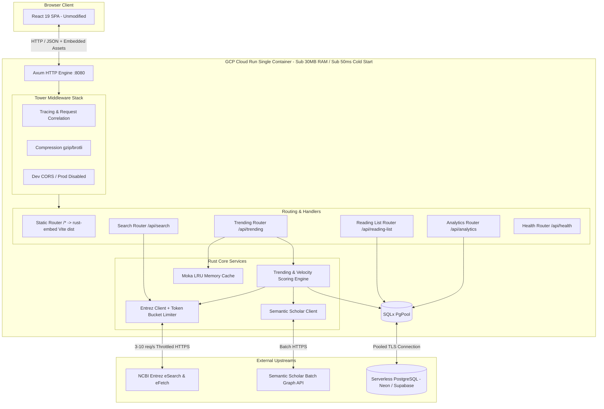

# Implementation Plan: Rust (Axum) & GCP Cloud Run Full-Stack Monorepo

## 1. Executive Summary & Architecture Topology

This plan details the senior engineering architecture and step-by-step vertical-slice execution strategy for migrating ResearchPulse from a Python FastAPI backend hosted on Railway to a high-performance Rust (Axum) service hosted on Google Cloud Run. The existing React 19 / TypeScript / Vite frontend in `researchpulse/frontend` is completely preserved and reused with zero modifications. The system is packaged into a single multi-stage Docker container deployed on Google Cloud Run, backed by a serverless PostgreSQL database (Neon or Supabase perpetual free tier), running 100% within GCP's perpetual free tier limits with zero idle infrastructure costs. Once verified, the existing Netlify deployment is pointed to the new Cloud Run instance, and the paid Railway subscription is canceled.

### System Architecture Diagram



---

## 2. Developer Manual Actions Checklist

To make responsibilities completely transparent, here is the exact checklist of items the developer must perform manually:

### Step 1: Google Cloud Project Setup
- [ ] Select or create GCP Project (`researchpulse-prod`) in Google Cloud Console.
- [ ] Ensure billing is linked to activate the perpetual free tier.
- [ ] Enable APIs:
  ```bash
  gcloud services enable run.googleapis.com artifactregistry.googleapis.com iamcredentials.googleapis.com
  ```
- [ ] Create Artifact Registry repository:
  ```bash
  gcloud artifacts repositories create researchpulse-repo \
      --repository-format=docker \
      --location=us-central1 \
      --description="ResearchPulse Docker images"
  ```
- [ ] Configure Workload Identity Federation (WIF) pool/provider for GitLab (or create a service account with `roles/run.admin` and `roles/artifactregistry.writer`).

### Step 2: Serverless PostgreSQL Setup
- [ ] Create free PostgreSQL instance on Neon (`neon.tech`) or Supabase (`supabase.com`).
- [ ] Save the connection string (with `?sslmode=require`).

### Step 3: GitLab CI/CD Variables
- [ ] Create repository on GitLab (`gitlab.com/<username>/researchpulse`).
- [ ] Populate variables under **Settings > CI/CD > Variables**:
  - `DATABASE_URL`
  - `GCP_PROJECT_ID`
  - `GCP_SERVICE_ACCOUNT`
  - `GCP_WIF_PROVIDER`

### Step 4: Verification, Domain Cutover & Canceling Railway
- [ ] Test the live Cloud Run URL (`https://<service>-<hash>.a.run.app`).
- [ ] Update DNS or Netlify site domain settings to point custom domain to Cloud Run.
- [ ] **Delete Railway Service**: In Railway dashboard, delete the legacy backend project to stop monthly billing permanently.

---

## 3. Monorepo Organization & Directory Topology

```
researchpulse/
├── Cargo.toml                    # Rust workspace manifest
├── Cargo.lock
├── backend/                      # Rust Axum service
│   ├── Cargo.toml
│   ├── migrations/               # SQLx database migrations
│   │   ├── 0001_create_saved_articles.sql
│   │   ├── 0002_create_trending_snapshots.sql
│   │   └── 0003_create_page_views.sql
│   └── src/
│       ├── main.rs               # Application entrypoint & server bootstrap
│       ├── config.rs             # Strongly typed environment configuration
│       ├── state.rs              # AppState shared state (PgPool, Moka cache, Clients)
│       ├── error.rs              # AppError enum + IntoResponse error translation
│       ├── routes/               # Axum route definitions
│       │   ├── mod.rs
│       │   ├── health.rs
│       │   ├── search.rs
│       │   ├── trending.rs
│       │   ├── reading_list.rs
│       │   ├── analytics.rs
│       │   └── static_files.rs   # rust-embed SPA handler + fallback to index.html
│       ├── services/             # Pure business & calculation logic
│       │   ├── mod.rs
│       │   ├── entrez.rs         # NCBI API integration + XML parsing
│       │   ├── semantic_scholar.rs
│       │   ├── trending.rs       # Scoring, velocity, notability, rank diffing
│       │   └── specialties.rs    # MeSH queries and specialty definitions
│       ├── models/               # Domain structs & DB entities
│       └── rate_limiter.rs       # Token-bucket rate limiter for Entrez
├── frontend/                     # Existing React 19 / TypeScript / Vite frontend (REUSED AS-IS)
│   ├── package.json
│   ├── vite.config.ts
│   ├── src/
│   └── dist/                     # Compiled SPA output embedded into Rust binary
├── Dockerfile                    # Multi-stage production container build
├── .gitlab-ci.yml                # CI/CD pipeline with GCP WIF keyless auth
└── docs/                         # PRD, Plan, and Handoff documentation
```

---

## 4. Database Layer Architecture & SQLx Migrations

### 4.1 Serverless PostgreSQL Configuration
- **Connection Strategy**: Uses `sqlx::postgres::PgPoolOptions` configured with:
  - `max_connections(5)`: Prevents exhausting serverless connection limits.
  - `min_connections(0)`: Allows idle scaling to zero.
  - `acquire_timeout(Duration::from_secs(8))`: Accommodates serverless Postgres wake-up latency.
  - `idle_timeout(Duration::from_secs(60))`: Cleans up dormant pooled connections.

### 4.2 SQL DDL Migrations
- `migrations/0001_create_saved_articles.sql`: `saved_articles` with unique `pmid`, `saved_at` timestamp with timezone, and composite indices.
- `migrations/0002_create_trending_snapshots.sql`: `trending_snapshots` storing calculated JSONB payloads by specialty, mode, and window_days.
- `migrations/0003_create_page_views.sql`: `page_views` for privacy-friendly pageview analytics.

---

## 5. External Clients, Resiliency & Caching Strategy

### 5.1 NCBI Entrez Rate Limiting
- Token bucket rate limiter: 3 req/sec without key, 10 req/sec with `NCBI_API_KEY`.
- Exponential backoff on HTTP 429 (`0.5s`, `1s`, `2s`, `4s`) up to 4 attempts.
- Streaming XML parser (`quick-xml`) with zero-copy buffer reuse.

### 5.2 Semantic Scholar Batch Lookup
- Batches up to 200 PMIDs per call using `POST /graph/v1/paper/batch`.
- Handles HTTP 400 safely when papers are unindexed, returning empty citation map.

### 5.3 In-Memory LRU Caching (`moka`)
- `search_cache`: TTL 30 minutes, 1,000 entries.
- `trending_cache`: TTL 4 hours, 100 entries.
- Stale-while-revalidate pattern using recent (<8h) Postgres snapshots.

---

## 6. Single Container Architecture & Embedded Frontend

The unmodified React 19 frontend is compiled into static assets (`dist/`) during Docker build stage 1, and embedded into the Rust executable via `rust-embed`:
- `/api/*` handled by Axum API router.
- `/*` serves static assets (`.js`, `.css`, SVG) with correct MIME types.
- Fallback route returns `index.html` for client-side HTML5 history navigation.
- **Zero CORS configuration required in production.**

---

## 7. GCP Perpetual Free Tier Sizing & Cost Governance

| Resource | GCP Perpetual Free Tier Limit | ResearchPulse Allocation | Margin / Headroom |
|---|---|---|---|
| **Cloud Run Requests** | 2,000,000 requests/month | ~100,000 requests/month | 95% free buffer |
| **Cloud Run Memory** | 360,000 GiB-seconds/month | 256 MiB container @ active CPU only | >90% headroom |
| **Cloud Run vCPU** | 180,000 vCPU-seconds/month | 1 vCPU throttled to zero when idle | >90% headroom |
| **Cloud Run Min Instances** | 0 (Scale to zero) | `min_instances = 0` | 0 idle costs |
| **Artifact Registry** | 0.5 GB storage/month | Single stripped binary image (~22MB) | 95% buffer |
| **Cloud Build** | 120 build-minutes/day | Handled via GitLab CI runners | 100% GCP free |
| **Database** | Neon / Supabase Free Tier | 0.5 GB Postgres with auto-suspend | 100% free |
| **Railway Cost** | Paid tier cancelled | **\$0.00 / month** | **100% cost elimination** |

---

## 8. GitLab CI/CD Pipeline & Workload Identity Federation

- Keyless OIDC JWT authentication against GCP WIF pool.
- Pipeline stages: `lint-and-test` (`cargo fmt`, `cargo clippy`, `cargo test`) $\to$ `build-and-deploy` (Docker build, Artifact Registry push, Cloud Run deploy).

---

## 9. Phased Vertical-Slice Implementation Milestones

### Milestone 1: Rust Axum Foundation & Static Asset Embedding
- **Goal**: Scaffold Axum server, configure Tokio runtime, implement healthcheck, and embed compiled React 19 SPA (`frontend/dist`) via `rust-embed`.
- **Validation**: `GET /api/health` returns JSON; `GET /` serves the unmodified React 19 web application.

### Milestone 2: Serverless Postgres & SQLx Migration Layer
- **Goal**: Implement SQLx connection pool, run automatic migrations on startup, and build Reading List CRUD (`GET /api/reading-list/`, `POST /api/reading-list/`, `DELETE /api/reading-list/{pmid}`, `GET /api/reading-list/citations`).
- **Validation**: Unit and integration tests verify article bookmarking, conflict handling (409), deletion, and citation retrieval.

### Milestone 3: NCBI Entrez Client & Search Parity
- **Goal**: Build `EntrezClient` with token-bucket rate limiter, streaming XML parser (`quick-xml`), in-memory Moka search cache, and `GET /api/search/` route.
- **Validation**: Exact response schema parity with legacy Python search endpoint; throttled to 3 req/s without key.

### Milestone 4: Semantic Scholar Client & Trending Engine
- **Goal**: Implement `SemanticScholarClient`, `TrendingEngine` with velocity calculation (`citations / (age_days + 21)`), notability tiers, slice sampling (90-day slices), snapshot diffing for rank movements, and `GET /api/trending/` & `GET /api/trending/availability`.
- **Validation**: Benchmarks verify rank movement indicators (`+3`, `-1`, `NEW`) and database snapshot persistence.

### Milestone 5: Analytics Event Ingestion
- **Goal**: Build `POST /api/analytics/pageview` and `GET /api/analytics/summary` computing today, week, month, year, and all-time buckets with path and referrer rankings.
- **Validation**: Unit tests verifying correct time-window bucket aggregation.

### Milestone 6: Docker Containerization & GitLab CI/CD with GCP WIF
- **Goal**: Author multi-stage Dockerfile, configure `.gitlab-ci.yml`, test Workload Identity Federation auth, and deploy to Cloud Run.
- **Validation**: Live deployment cold start <50ms, RAM footprint <30MB, zero monthly cost verified in Google Cloud Console.

### Milestone 7: Production Verification, Netlify Cutover & Railway Decommissioning
- **Goal**: Run end-to-end smoke tests against Cloud Run production URL, repoint custom domain/DNS (or Netlify proxy/rewrite) to Cloud Run, and cancel the Railway backend service.
- **Validation**: Production traffic flowing to Cloud Run; Railway subscription deleted; \$0.00 monthly run-rate achieved.

---

## 10. Verification & Quality Protocol

- **Static Analysis & Linting**: Zero warnings tolerated (`cargo clippy -- -D warnings`, `cargo fmt --check`).
- **Test Discipline**: Strict AAA structure (`// Arrange`, `// Act`, `// Assert`) across unit and integration tests.
- **Contract Verification**: Integration test suite verifying byte-for-byte JSON payload compatibility with `frontend/src/utils/api.ts` and `frontend/src/types/index.ts`.
- **Performance Verification**: In-container memory benchmarking to verify active heap <30MB.
